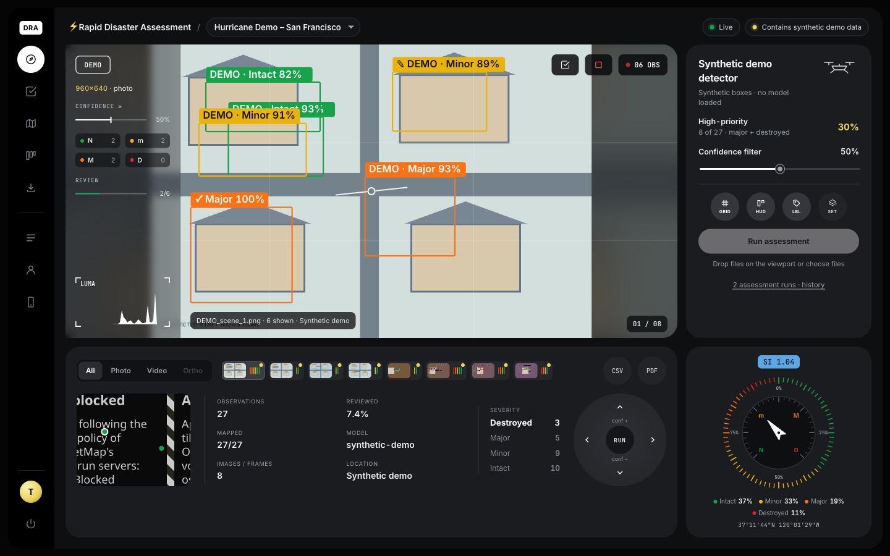

# ⚡ Rapid Disaster Assessment & Rescue Planner

A self-hosted platform that takes a response team from raw drone and phone imagery to reviewed, mapped and assigned rescue work:

1. **Assess.** Upload photos, drone video (with DJI `.SRT` telemetry) or GeoTIFF orthomosaics. Damage detection runs in the background with live progress.
2. **Review.** Analysts confirm, correct or reject every detection, draw buildings the model missed, tag hazards and add notes. Every decision is logged. An optional Claude vision second opinion flags disagreements.
3. **Locate.** Detections are placed on the map using GeoTIFF georeferencing, drone telemetry projection, EXIF GPS or a manual reference, then matched to building footprints (OpenStreetMap or your own) so each building is counted once.
4. **Act.** Coordinators turn high-priority buildings into tasks, assign crews and plan route order. Crews work from an offline-capable phone app that syncs field reports and photos.
5. **Share.** Export a PDF situation report, CSV, GeoJSON, KML or Shapefile, or give partner agencies an expiring read-only link.



## 1. Run it

**Judge demo (fastest):** connect Claude, either with `ant auth login` (Anthropic CLI sign-in) or by putting `ANTHROPIC_API_KEY=...` in `disaster_assessor/.env`. Then run `./start-demo.sh`. It sets up Python, seeds a Hurricane Ian incident from real NOAA aerial imagery analysed by Claude, and opens the app. The 5-minute walkthrough is in [DEMO.md](DEMO.md).

**Manual:**

```sh
cd disaster_assessor
python3 -m venv .venv && source .venv/bin/activate
pip install -r requirements-demo.txt      # core platform, no PyTorch
python server.py                          # → http://127.0.0.1:8000
```

On the first visit you create the **administrator** account (or start with `DRA_NO_LOGIN=1 python server.py` to skip sign-in when you're the only user on this machine). Then create an incident, open its console and click **Run the synthetic demo** to see the whole workflow without a model.

Python 3.11+ is required (3.12 is tested). Real model inference needs `pip install -r requirements.txt` (PyTorch + Ultralytics).

**Docker:** `docker compose up -d` (see `docker-compose.yml`). Data lives in the `dra-data` volume, and model weights are mounted from `./models`.

| App | URL | Who |
| --- | --- | --- |
| Console | `/` | admins, coordinators, reviewers |
| Field app (installable, offline) | `/field/` | rescue crews on phones |
| Shared view | `/share/<token>` | partner agencies, no account |
| API docs | `/api/docs` | integrators |
| Classic Streamlit demo | `streamlit run app.py` | offline single-user demo |

## 2. Roles

| Role | Can |
| --- | --- |
| **admin** | everything, plus users, backups, retention, audit log |
| **coordinator** | incidents, crews, tasks, routes, footprints, imagery overlays, share links |
| **reviewer** | run assessments, review observations, draw missed buildings |
| **field** | the field app: assigned tasks, status updates, reports with photos and GPS |

Lost the admin password? Run `python -m app.cli create-user rescue-admin --role admin`.

## 3. Workflow in the console

- **Console:** drop files on the viewport. The run is queued and processed in the background, with progress streamed live to everyone viewing the incident. Use **SET** to choose the model mode, video sampling, a manual reference point and the Claude second opinion.
- **Review** (`R` from the console). Keys: `1`–`4` set class, `C`/`Enter` confirm, `X` reject, `N` next unreviewed, `J`/`K` next/previous box, `[`/`]` previous/next image, `D` draw a missed building, `E` redraw the selected box. **Confirm image** accepts every remaining box in the current image.
- **Rescue map:**
  - Map layers: capture points (split-colour rings show mixed damage), building footprints coloured by their worst non-rejected class (dashed outline = not fully reviewed), a damage-density heatmap, tasks and planned routes.
  - Pre-/post-event GeoTIFF overlays with a swipe comparison.
  - Filters by run and by review status.
  - **Import OSM buildings** for the visible area, or upload a footprint GeoJSON.
- **Tasks & crews:**
  - **Create tasks for high-priority** (Major and Destroyed observations without a task).
  - Assign crews and drag cards between status columns.
  - Open a task to see field reports and photos.
  - Plan a route per crew on the map.
- **Export & share:** six formats, filtered by "reviewed only" and minimum score. Share links expire and never include crew assignments or reviewer identities.

## 4. Where locations come from

| `location_source` | Meaning | Accuracy |
| --- | --- | --- |
| `ortho_georef` | Box centre on a georeferenced GeoTIFF (EPSG:4326, 3857, UTM via pyproj) | as good as the mosaic |
| `telemetry_projection` | DJI XMP/SRT altitude + gimbal pitch/yaw project the box centre onto flat ground | tens of metres; assumes flat terrain at take-off height |
| `drone_telemetry` / `exif_camera` | Camera position only | the building is somewhere in view |
| `manual_reference` | One operator-chosen point for the whole run | coarse |
| `synthetic_demo` | Simulated near the incident centre (demo mode only) | not real |
| `device_gps` | Field-photo location from the crew's phone | phone GPS |

Footprint matching assigns each located observation to the containing building (or the nearest one within 25 m). The building view and the buildings export then count each building once, even when several photos or video frames show it. In sampled video, detections are also linked across frames into tracks.

## 5. Models

**Claude vision (default when Claude API access is available):** authenticate with an API key (`ANTHROPIC_API_KEY`) or an Anthropic CLI sign-in (`ant auth login`); the SDK finds either automatically. API usage is billed through a Claude Console account: Max plans include linkable monthly API credit, and Pro plans don't include API usage.
- Claude Opus 5.5 finds each building and returns a box, a damage class on the xBD scale, a confidence, the visible evidence and hazards. The evidence is shown in Review as "Claude's assessment".
- It works on drone, aerial and phone photos with no GPU or training. Large aerial mosaics are split into overlapping 1280 px tiles and the boxes are merged.
- Each run records its token usage and estimated cost. It needs internet, and images are sent to the Anthropic API.
- Accuracy hasn't been measured against a benchmark; treat results as a first pass for human review.

**Trained models:** no damage-trained weights are bundled, and standard COCO `yolov8n.pt`/YOLO11 weights are rejected because they don't classify damage. There are two supported paths:

- **Two-stage (recommended):** a building detector, then a damage classifier on each crop. Train both on xBD/xView2 with `training/` (see [training/README.md](training/README.md)), copy the `.pt` files into `models/`, and pick them under console **SET**. You can also set `DRA_BUILDING_MODEL`/`DRA_DAMAGE_MODEL`.
- **Single model:** one YOLO detection model whose four classes are `No Damage`, `Minor Damage`, `Major Damage`, `Destroyed`.

Weights load only from the `models/` folder, because PyTorch checkpoints can execute code, so use trusted files only. Satellite-trained models transfer poorly to oblique drone or street-level photos, so fine-tune on local labelled imagery and validate before operational use. Model scores are uncalibrated; they are not probabilities of damage.

**Claude second opinion (optional):** set `ANTHROPIC_API_KEY`, then enable it per run. Crops of Major and Destroyed detections are sent to the Anthropic API for an independent class, rationale and hazards. These appear in Review and never change classes on their own.

## 6. Configuration (environment variables)

`server.py` and the CLI read `disaster_assessor/.env` first (copy `.env.example`). Real environment variables take precedence.

| Variable | Default | Purpose |
| --- | --- | --- |
| `HOST` / `PORT` | `127.0.0.1` / `8000` | bind address |
| `DRA_NO_LOGIN` | off (on in `.env.example`) | `1` = single-user local mode: no sign-in, you are the built-in local admin. Only allowed on a localhost bind and only answers requests addressed to localhost; never use it behind a reverse proxy |
| `DRA_DATA_DIR` | `./data` | database, imagery, backups |
| `DRA_MODELS_DIR` | `./models` | allowed model weights |
| `DRA_DEVICE` | `cpu` | `cpu`, `mps` (Apple), `cuda:0` |
| `DRA_WORKERS` | `1` | concurrent assessment jobs |
| `DRA_PUBLIC_URL` | — | absolute links in alerts and share links |
| `DRA_SECURE_COOKIES` | off | set to `1` behind HTTPS |
| `DRA_SESSION_HOURS` | `12` | sign-in lifetime |
| `DRA_TILE_URL` / `DRA_TILE_ATTRIBUTION` | OpenStreetMap | basemap; use your own tile server for offline or heavy use |
| `DRA_OSRM_URL` | — | road routing ([OSRM](https://project-osrm.org)) |
| `DRA_SLACK_WEBHOOK` | — | alert when Destroyed is detected |
| `DRA_WEBHOOK_URL` / `DRA_WEBHOOK_SECRET` | — | signed JSON webhook (`X-DRA-Signature`, HMAC-SHA256) |
| `ANTHROPIC_API_KEY` | — | Claude vision detection and second opinion (put it in `disaster_assessor/.env`, which is git-ignored) |
| `DRA_DETECT_MODEL` / `DRA_DETECT_EFFORT` | `claude-opus-5-5` / `medium` | Claude vision detector model and effort |
| `DRA_VISION_MODEL` | `claude-opus-5-5` | second-opinion model |
| `DRA_RETENTION_DAYS` | off | daily deletion of closed incidents older than N days |
| `DRA_KEEP_UPLOADS` | off | keep raw uploads after processing |
| `DRA_ALLOWED_ORIGINS` | — | extra origins allowed to POST (comma-separated) |

## 7. Operations and security

- **Data:** SQLite (WAL mode) plus image files under `DRA_DATA_DIR`. Back up from Admin → **Back up now**, or with `python -m app.cli backup`; a backup is a consistent database snapshot plus imagery. Retention: `python -m app.cli retention 180 --apply`.
- **Built-in protections:**
  - scrypt password hashes and HTTP-only SameSite session cookies.
  - Login throttling and an origin check on every write.
  - A strict Content-Security-Policy.
  - Role checks on every endpoint and an audit log of sign-ins, edits, exports and shares.
- **Before network exposure:**
  - Keep the default localhost bind, or put a TLS reverse proxy in front.
  - Set `DRA_SECURE_COOKIES=1` and `DRA_PUBLIC_URL`.
  - Imagery and EXIF can reveal sensitive locations.
- **External requests:**
  - Map tiles for the viewed area.
  - Leaflet and fonts from unpkg/Google Fonts in the console.
  - The Overpass API only when someone imports OSM buildings.
  - The Anthropic API and webhooks only when configured.
  - The field app's shell works fully offline.

## 8. Limits and honest caveats

- Observations are model output until a reviewer confirms them. Exports and reports label demo data and unreviewed output.
- Severity ranking orders review work. It does not confirm occupancy, structural safety or safe access.
- Straight-line route ordering ignores roads. OSRM uses pre-disaster road data and can't see closures or debris.
- Telemetry projection assumes flat ground and no lens distortion, so verify on the ground.
- Field reports synced late show the time the crew made them; the server de-duplicates retries.

## 9. Development

```sh
python -m unittest discover -s tests -v    # 86 tests: services, training, platform API, Streamlit app
python -m compileall -q app.py server.py app utils training tests
for f in web/js/*.js web/js/views/*.js web/field/*.js web/share.js; do node --check "$f"; done
```

**Layout:**
- `app/`: FastAPI platform (routes, services, jobs, auth, db).
- `utils/`: detection, geo, exports, video, shared pipeline.
- `training/`: xBD pipeline.
- `web/`: console (ES modules, no build step), field PWA, share page.
- `tests/`: the test suite.
